# Annotations Viewer (All Notes & Highlights) Plugin for KOReader

This plugin scans KOReader's stored annotations (highlights and notes) and provides a single unified interface to browse, filter and manage them across all books you've read.

Key behaviors:
- Aggregates highlights and notes from KOReader
- Shows book title, date, chapter, highlighted text and any user note for each annotation
- Lets you open the source book at the annotated location
- Edit or delete annotations, change highlight style or color
- Extensive annotations filtering system enabling filtering by highlight color, style, books, tags, chapters, words in highlights and notes using inclusion and exclusion
- Save a filter and bring it back with one tap
- Caching annotations for faster loading
- A review mode that hides the text so you can test yourself, covering either the whole
  annotation, only the words you picked, or showing a question you wrote for it
- Configure fonts, margins, spacing, truncation length and many more display options from the plugin Settings menu for lots of customization

## Features

- Unified view of all annotations across books
- Pagination for long annotation lists, with swipes, page keys or Prev / Next buttons
- Chapter headings in the list, styled like the book title
- Filter by highlight color, style (underline/strikeout/invert/lighten), books, tags, chapters, highlight text and note text using inclusions and/or exclusions
- Saved filters, shown as chips in Filter & sort
- Sort in up to three steps: date, last opened book, author, book, filename or place in the book. A single book sorts by date, position or chapter. All annotations and a single book keep their own sort
- Search matches are underlined in highlights and notes
- Edit note text in-place and save back to the book's settings
- Change highlight style and color and save back to book settings
- Delete annotations
- Go to the highlighted location in the reader
- **Review mode**: cover annotation text to test your recall (see below)
- **Custom cover**: per annotation, hide only the words you picked, or replace the text
  with a question you wrote for it
- **Export** to Markdown, plain text, HTML or EPUB, one file or one per book (see below)
- Tap and long press on an annotation are configured separately (jump to the highlight or
  open its card)
- Works in portrait and landscape, the list redraws when you rotate. Landscape width is a setting
- Night mode keeps the real highlight colors
- Chinese, Japanese and Korean text wraps correctly
- Choose how many lines a note shows before it ends with "...", tap it to read all
- Line spacing (also negative), and a separate font, size, space above and indent for notes
- Own font and size for the author name, and capitals or as written for titles, the chapter / date line and the author
- Scrollbar marks follow the sort order: books, authors, months or chapters
- Menus and dropdowns pass gestures you don't use on to KOReader
- Everything scales with your screen DPI
- Customize fonts, margins, spacing, truncation and many other options

## Usage

1. Open KOReader.
2. From the file cabinet menu or within a book select `Annotations`.
3. Browse the list of annotations. Tap an item to jump to it in the book, or long press it
   to open its card (both can be swapped in Settings):
   - Open book at annotation
   - Edit note text
   - Change highlight style or color
   - Delete annotation
4. Use the tabs at the top to narrow the list: All, Highlights, Notes, Custom, Bookmarks.

The tabs are filters on top of the ones in Filter & sort. `Custom` lists the annotations
that have picked words or a question of their own, and only appears once there are any.

The `☰` menu of the list has `Export`, which writes the notes being shown — see **Export**
below — and `Copy`, which puts the same text on the clipboard.

Use the plugin Settings (accessible from the plugin menu) to adjust fonts, font sizes, margins, spacing and other display preferences. Text and spacing have their own page with a preview on top.

## Review mode

Review mode covers annotation text so you can test whether you remember it. It is switched
on and off from the eye icon in the top bar of the list, and remembers its state.

While review mode is on:
- A tap on a row shows it, and another tap hides it again, as often as you like. Only the eye
  icon leaves the mode.
- Text is hidden in the annotation's own color, so a yellow highlight reads as an empty yellow
  bar. Lines keep their exact width and the page does not move.
- Settings decides what is hidden:
  - **Which styles** to cover (highlight, underline, strikeout, invert), all four by default.
  - **Always cover notes**: a note is hidden even when its style is not covered above.
    Choosing no style at all turns this on, so "notes only" always hides the notes.
  - **Cover only the note when there is one**: a highlight that has a note keeps its text and
    only the note is hidden, so the highlight can be read and the note recalled from it.
- Long pressing a row still opens its card (or jumps, as set), so annotations can be edited
  without leaving the mode.

## Custom cover

A finer way to cover, on top of the whole-line cover above. Every annotation can have its own,
in either of two modes. The `Custom` tab in the list shows the annotations that have either.

### Question

Write a question for the whole annotation, with the annotation itself as the answer:

1. Long press the annotation and tap `Add a question…` in its card.
2. In review mode the annotation's text is replaced by that question, drawn in bold with a
   question mark at the end (one is added if you did not write it).
3. Tap the row to swap between the question and the text, and back.

One question per annotation. Tapping its badge in the card drops it.

### Picked words

Cover only some words of an annotation instead of all of it:

1. Long press the annotation and tap `Choose words…` in its card.
2. The field is filled with the whole annotation. Delete everything that should stay readable,
   leaving only what should be covered, then tap `Add`.
3. Each pick is saved at once and the field goes back to the whole annotation, ready for the
   next one. `Reselect` puts the text back if you deleted too much.
4. In review mode only those words are covered; the rest of the line stays readable. A picked
   phrase longer than a line is still covered where it wraps.

Picked words win over "Cover only the note when there is one": a highlight with a note stays
readable, but its picked words are hidden. A question wins over picked words, since it replaces
the whole text.

Settings, under `Custom cover`, splits into `Question` and `Picked words`, each with a note on
how it is used, a switch, and a count with `Remove all`:
- **Always show questions** / **Always cover picked words**: hide them even when their style is
  not covered above, so a style left unticked does not show them.
- **Remove all** covers what the list is showing right now, not every book: with one book open
  it clears that book's annotations, and in the whole-library list it clears whatever the
  filters leave.

## Export

Settings → `Export` writes what the list is showing, filters included, to a file you can read
elsewhere or keep outside KOReader.

### Formats

| Format | What you get |
| --- | --- |
| Markdown | Headings, quotes for the highlights, your notes. Opens in any editor, Joplin, Obsidian, pandoc |
| Plain text | The same without any markup, for a plain viewer or a printout |
| HTML | A complete document KOReader opens and renders by itself; also fine in a browser |
| EPUB | A real EPUB 2 book: a table of contents, page turns, adjustable font size |

The HTML and EPUB files are marked as belonging to the series `Annotations` (`Bookmarks` for a
bookmark-only list), so they can be told apart from the books they quote.

### Order

Two settings under `Order`:

- **Books**: each book once (the default), or as in the list — the second keeps the books in the
  order the list shows them, so one book can appear more than once if other books come between.
- **Chapters**: in book order (the default) or as in the list. Book order uses the same
  comparison as the list's own `Position` sort, so the chapters — and the notes inside each
  chapter — follow the book.

### What goes in

Independently of the format:

- The book title and author, the chapter (in the info line, as a heading, or not at all), the
  date, the page number, the highlight's colour and style, your notes, and the tags.
- **Title and filter at the top**: on, the file starts with `Annotations` and a line naming the
  filters that were applied; off, it starts with the book, its chapters or the first note. Off by
  default. The plain text, Markdown, HTML and EPUB exports all follow it.
- **Files**: one file, or one per book (named after the book).

A file that holds a single book does not repeat the book's name as a heading — the name is
already the file's name and, for HTML and EPUB, the document's title.

### Where they go

To `koreader/exports` by default, or a folder you choose. The folder is shown in Settings and
can be changed there. File names are built from the book's name, cleaned of characters a file
system refuses and cut at about 80 bytes, with the date and time added unless you turn that off
(off means exporting again replaces the same file).

### Preview

Settings → `Export` shows a preview of the file above the settings, drawn in the chosen format,
so the effect of each setting can be seen before writing anything.

## Where the settings live

Your picks and questions are display choices, so they are kept in the plugin's own settings
file, `koreader/settings/annotationsviewer.lua`, keyed by book path and annotation, and never
written into the book's sidecar. The other settings (fonts, margins, review mode styles) live
in the same file.

## Screenshots

Overview of every page:

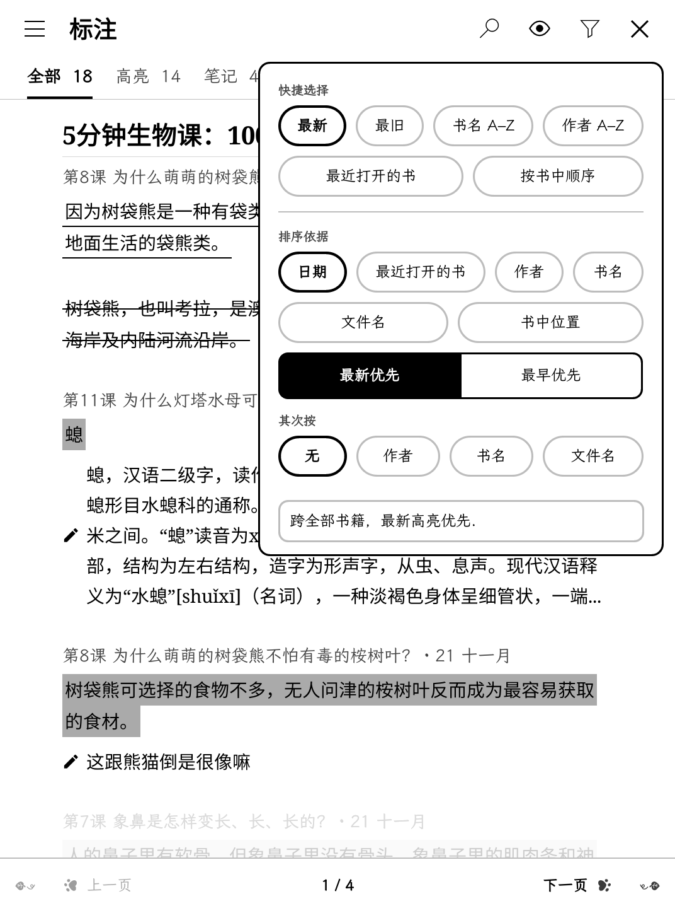
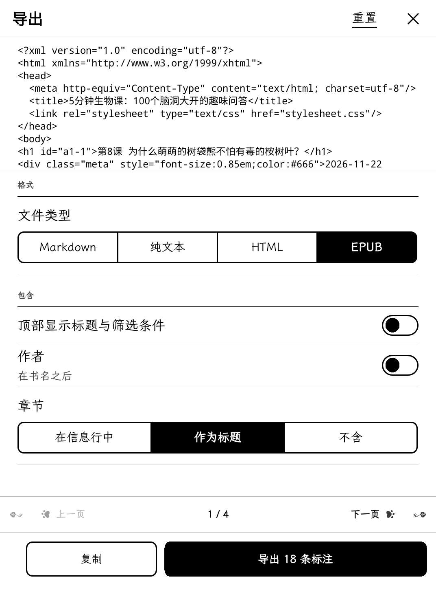
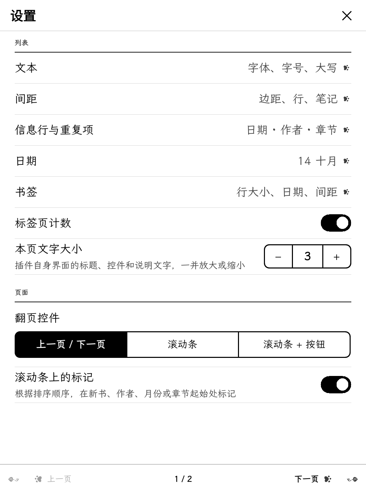

### The list

The tabs on top (All, Highlights, Notes, Custom, Bookmarks), the funnel for Filter & sort, the
eye for review mode, and the ☰ menu with Export, Copy and Settings.

### Review mode

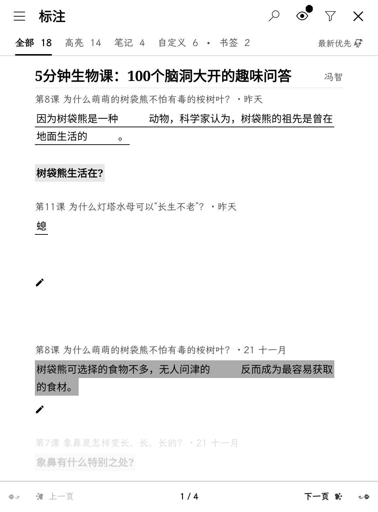
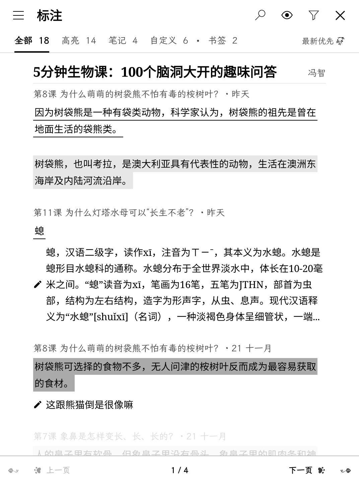
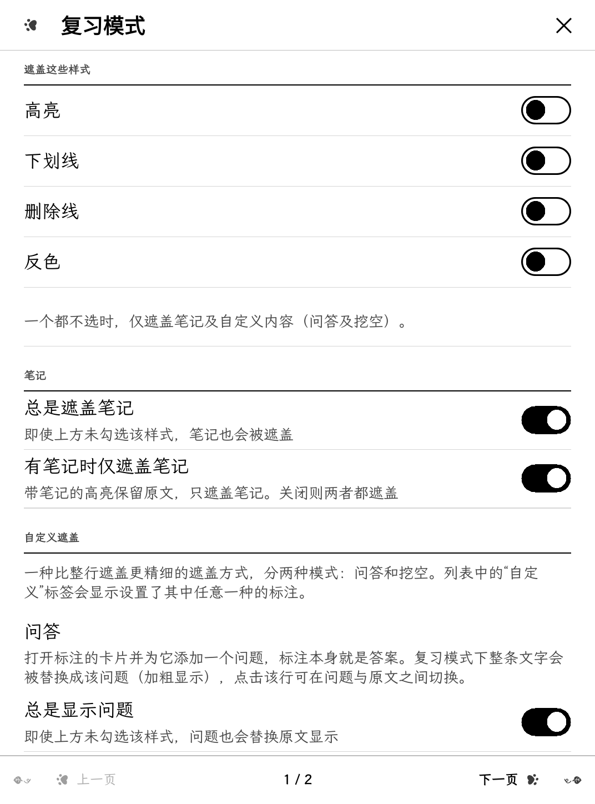
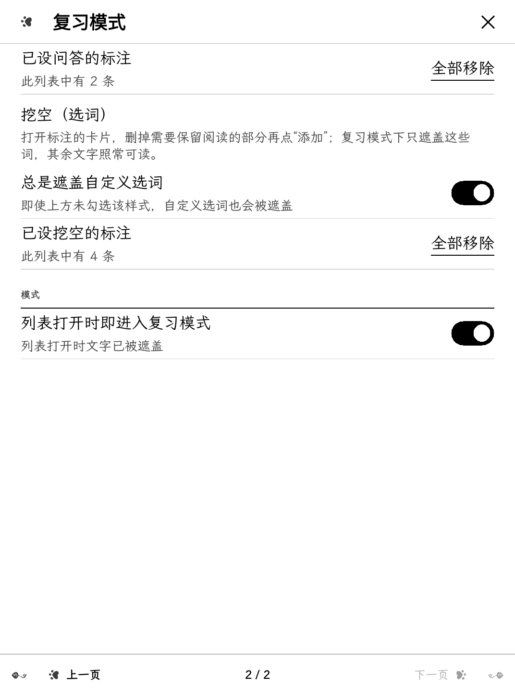

The first two are the same page with the eye on and off: covered text keeps the highlight's own
colour and its exact lines, so the page never jumps.

### Custom cover

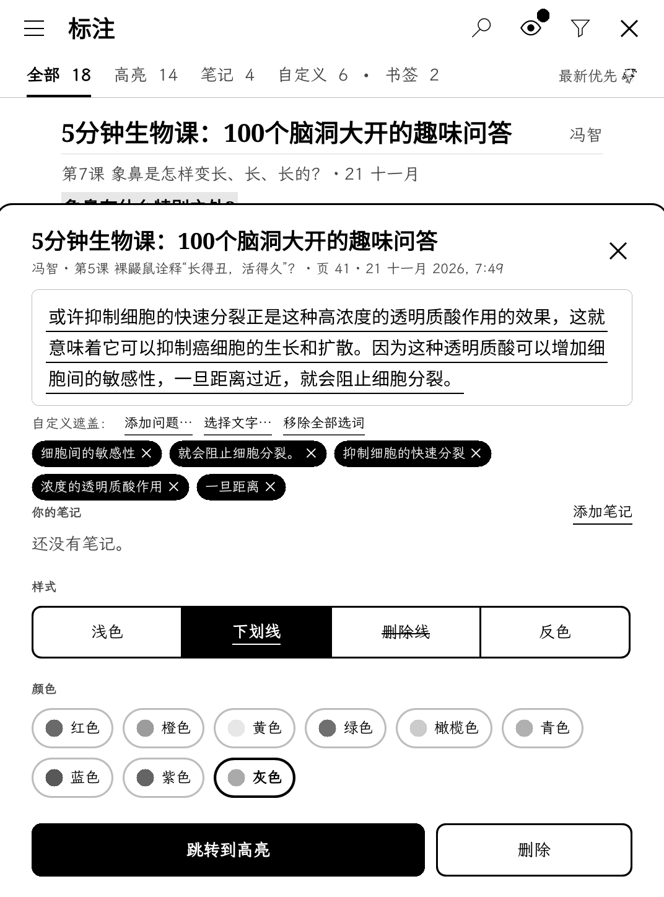
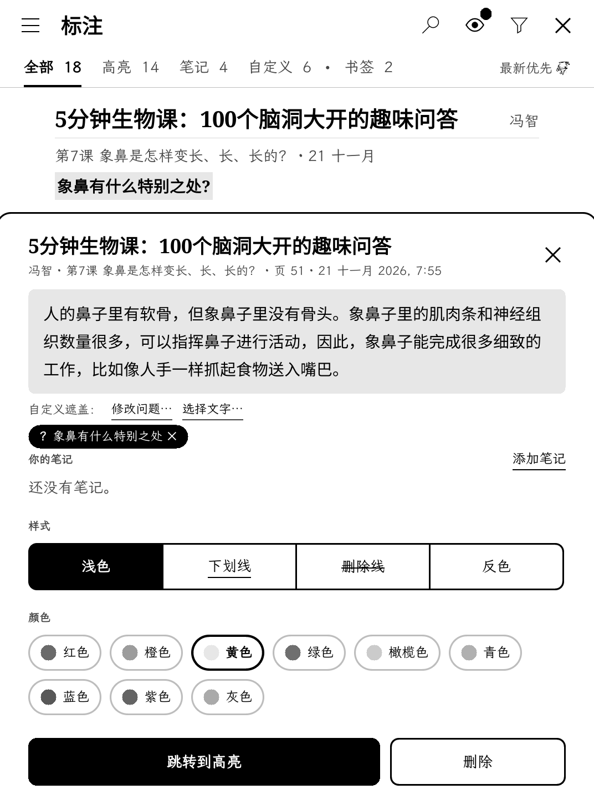

The card lists the picked words as chips, each removable, and shows the question in place of the
picked words once there is one.

### Export

The preview at the top is drawn in the format being chosen — here the XHTML of the EPUB — so each
setting can be judged before writing anything.

### Settings

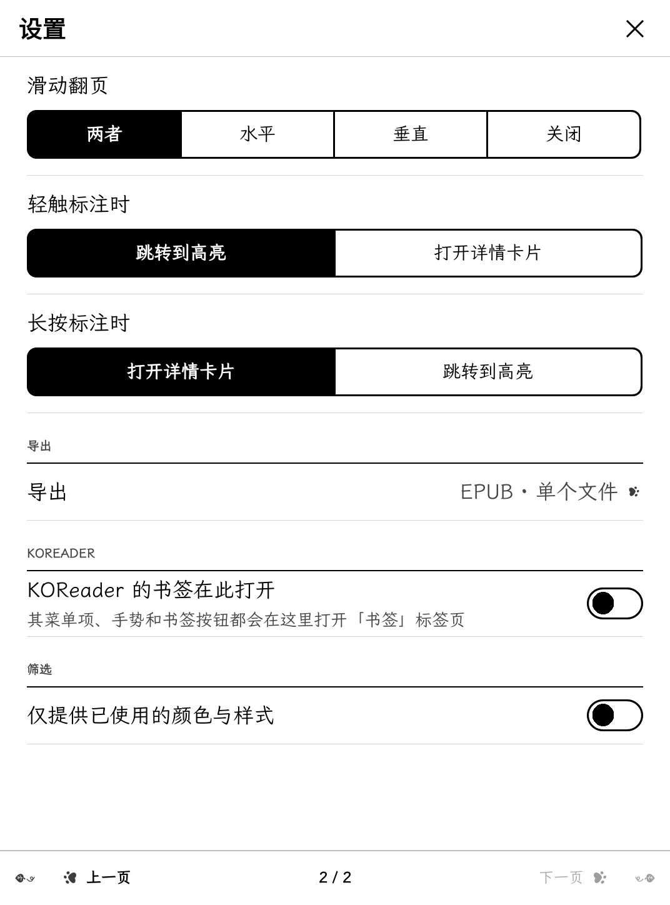

### Filter & sort

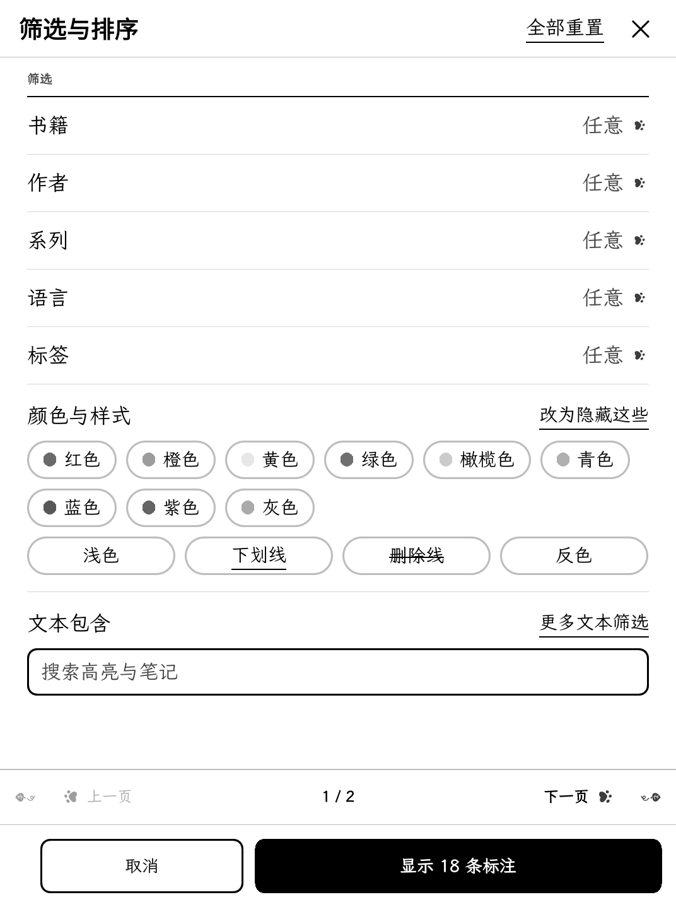

The first page filters: book, author, series, language and tag pickers, the colours and styles
(each usable as "only these" or "hide these"), and a search field. The second sorts, by up to
three keys, each ascending or descending, with the quick choices above them.