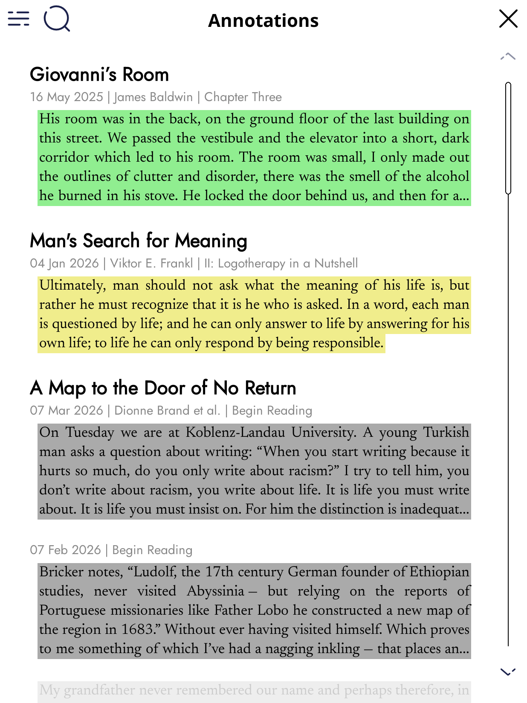
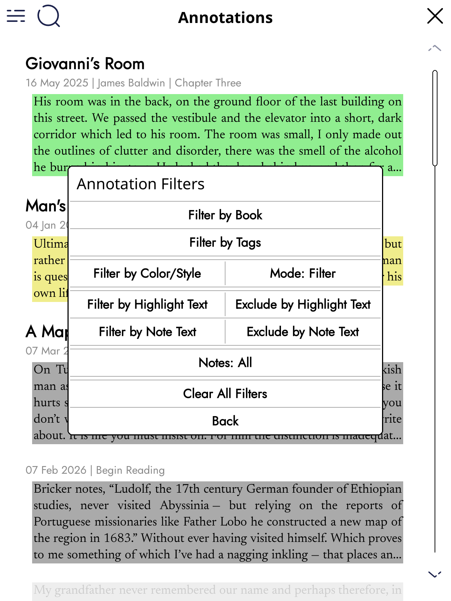
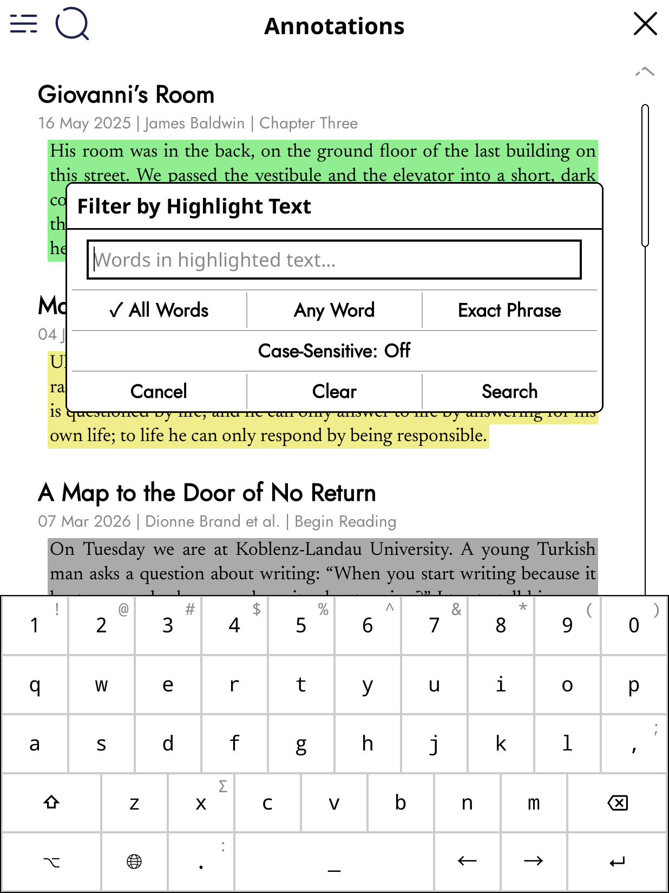
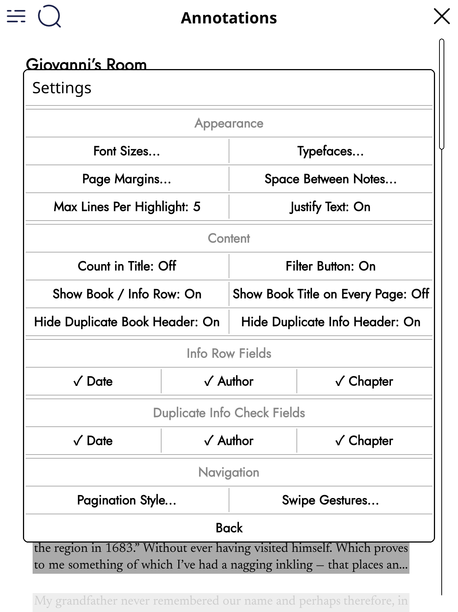

# Annotations Viewer (All Notes & Highlights) Plugin for KOReader

This plugin scans KOReader's stored annotations (highlights and notes) and provides a single unified interface to browse, filter and manage them across all books you've read.

Key behaviors:
- Aggregates highlights and notes from KOReader
- Shows book title, date, chapter, highlighted text and any user note for each annotation
- Lets you open the source book at the annotated location
- Edit or delete annotations, change highlight style or color
- Extensive annotations filtering system enabling filtering by highlight color, style, books, tags, chapters, words in highlights and notes using inclusion and exclusion
- Save a filter and bring it back with one tap
- Caching annotations for faster loading
- Configure fonts, margins, spacing, truncation length and many more display options from the plugin Settings menu for lots of customization

## Features

- Unified view of all annotations across books
- Pagination for long annotation lists, with swipes, page keys or Prev / Next buttons
- Chapter headings in the list, styled like the book title
- Filter by highlight color, style (underline/strikeout/invert/lighten), books, tags, chapters, highlight text and note text using inclusions and/or exclusions
- Saved filters, shown as chips in Filter & sort
- Sort in up to three steps: date, last opened book, author, book, filename or place in the book. All annotations and a single book keep their own sort
- Search matches are underlined in highlights and notes
- Edit note text in-place and save back to the book's settings
- Change highlight style and color and save back to book settings
- Delete annotations
- Go to the highlighted location in the reader
- Works in portrait and landscape, the list redraws when you rotate. Landscape width is a setting
- Night mode keeps the real highlight colors
- Chinese, Japanese and Korean text wraps correctly
- Choose how many lines a note shows before it ends with "...", tap it to read all
- Line spacing (also negative), and a separate font, size, space above and indent for notes
- Own font and size for the author name, and capitals or as written for titles, the chapter / date line and the author
- Scrollbar marks follow the sort order: books, authors, months or chapters
- Menus and dropdowns pass gestures you don't use on to KOReader
- Everything scales with your screen DPI
- Customize fonts, margins, spacing, truncation and many other options

## Usage

1. Open KOReader.
2. From the file cabinet menu or within a book select `Annotations`.
3. Browse the list of annotations. Tap an item to view details and access actions:
   - Open book at annotation
   - Edit note text
   - Change highlight style or color
   - Delete annotation

Use the plugin Settings (accessible from the plugin menu) to adjust fonts, font sizes, margins, spacing and other display preferences. Text and spacing have their own page with a preview on top.

## Screenshot

